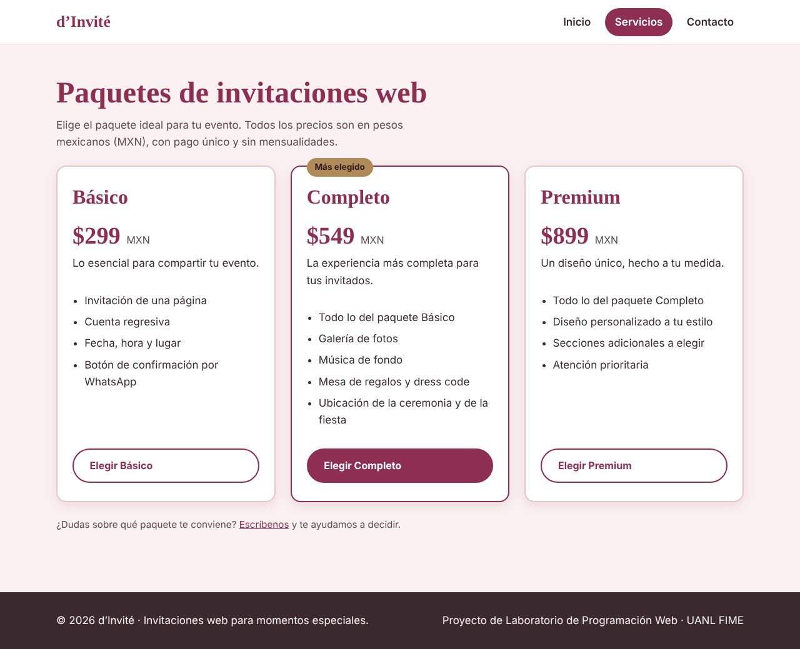
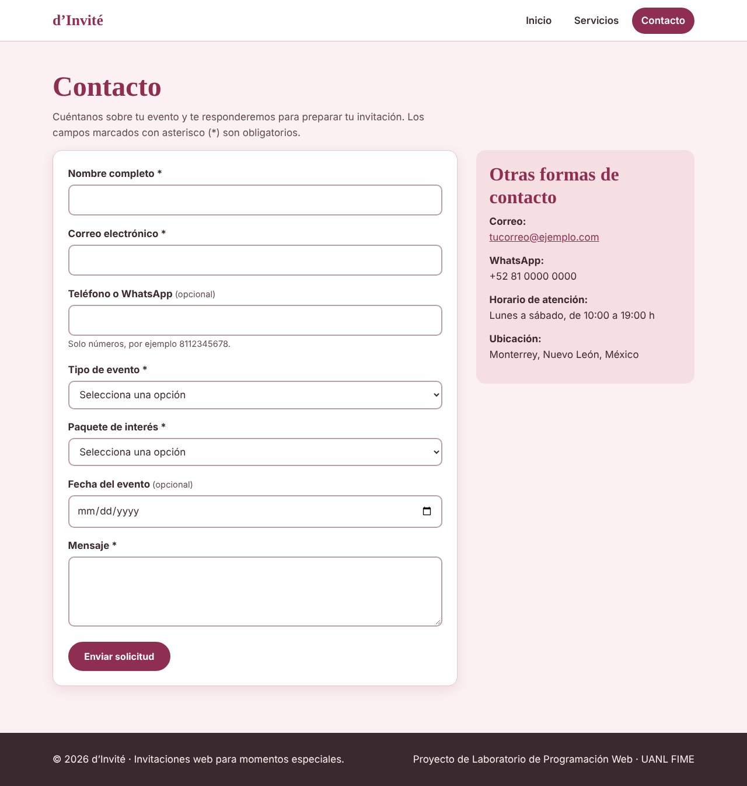
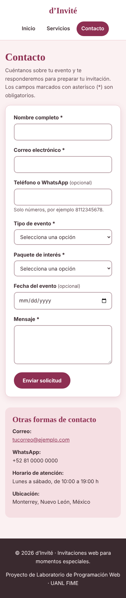
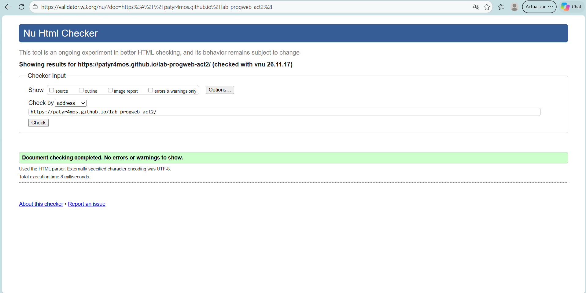
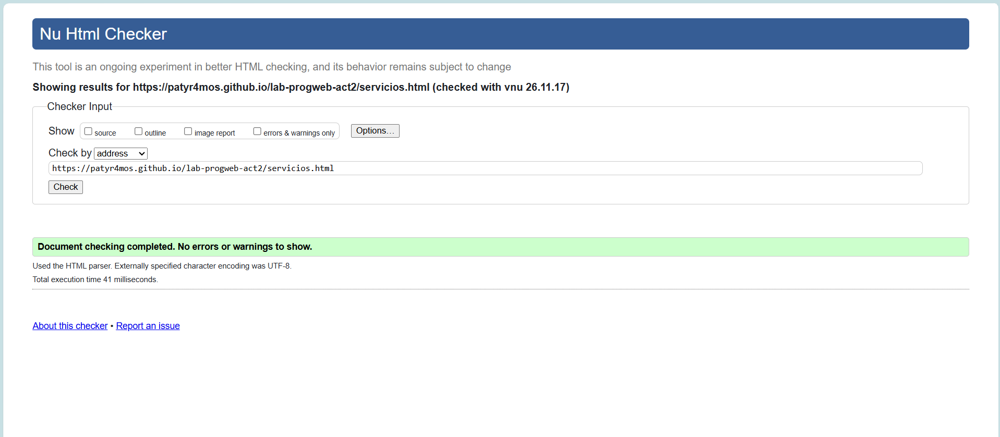
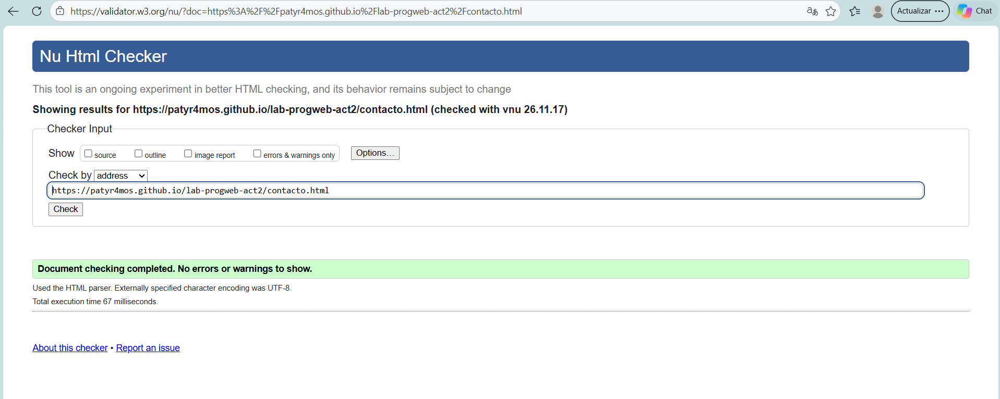
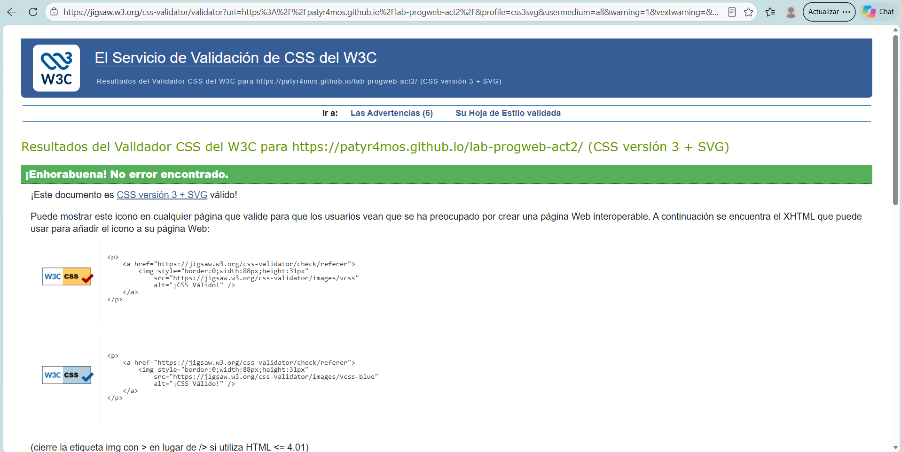

# d’Invité — Sitio web de invitaciones digitales

**Actividad 2. Desarrollo de un sitio web responsivo, semántico y accesible**
Laboratorio de Programación Web · UANL FIME · Agosto–Diciembre 2026
Autora: Patricia Lizeth Ramos Ortiz (matrícula 2161739)

🔗 **Sitio publicado:** https://patyr4mos.github.io/lab-progweb-act2/

📦 **Repositorio:** https://github.com/patyr4mos/lab-progweb-act2

## Objetivo

Construir y publicar un sitio web responsivo con HTML5 semántico y CSS moderno, aplicando principios de usabilidad, accesibilidad y validación de estándares. El caso elegido es **d’Invité**, un pequeño negocio de invitaciones web (digitales) para eventos como XV años, bodas y bautizos.

## Tecnologías

- HTML5 semántico (`header`, `nav`, `main`, `section`, `article`, `aside`, `footer`)
- CSS3 con **Flexbox** (encabezado, navegación, botones, pie de página) y **Grid** (hero, tarjetas, paquetes, contacto)
- Variables CSS, `clamp()` y media queries
- Git y GitHub Pages para el despliegue
- Sin frameworks ni librerías externas (sin JavaScript)

## Estructura del proyecto

```
├── index.html        # Inicio
├── servicios.html    # Servicios / paquetes
├── contacto.html     # Contacto (formulario)
├── css/styles.css    # Estilos
├── assets/           # Imágenes SVG (invitación de ejemplo y favicon)
├── docs/             # Capturas (vistas y validación W3C) para este README
└── README.md
```

## Vistas del sitio

1. **Inicio:** presentación del negocio, cómo funciona y lo que incluye una invitación.
2. **Servicios:** paquetes Básico ($299), Completo ($549) y Premium ($899 MXN), pago único.
3. **Contacto:** formulario con etiquetas, validación nativa y datos de contacto.

## Diseño responsivo

- Enfoque fluido: contenedor con `min()`, tipografía con `clamp()` y cuadrículas `auto-fit`.
- **Breakpoints:** `860px` (tablet: el hero y el contacto pasan a una columna) y `600px` (teléfono: navegación centrada, botones a ancho completo, encabezado no fijo).
- Probado en vista de escritorio (1280 px) y móvil (390 px) con las herramientas de desarrollo del navegador.

| Página | Escritorio | Móvil |
|---|---|---|
| Inicio |  |  |
| Servicios |  |  |
| Contacto |  |  |

## Accesibilidad aplicada

- `lang="es"`, títulos descriptivos por página y jerarquía de encabezados correcta (un `h1` por página; `h2` y `h3` en orden).
- Enlace “Saltar al contenido principal” y navegación con `aria-label` y `aria-current="page"`.
- Texto alternativo en la imagen principal (`alt`) y título/descripción en el SVG.
- Todos los campos del formulario con `<label>` asociado, indicación de campos obligatorios y texto de ayuda con `aria-describedby`.
- Contraste de color alto (texto `#3A2A2F` sobre `#FBF1F2`; botones blancos sobre `#8E2F52`, relación aproximada 7:1).
- Foco visible en enlaces, botones y campos; se respeta `prefers-reduced-motion`.
- Navegable completamente con teclado; tamaños de texto relativos (`rem`).

## Resultados de validación

Se validó el sitio publicado con las herramientas del W3C (fecha: 19/11/2026).

| Herramienta | Página / archivo | Resultado |
|---|---|---|
| W3C Markup Validation Service (Nu Html Checker) | `index.html` | Sin errores ni advertencias |
| W3C Markup Validation Service (Nu Html Checker) | `servicios.html` | Sin errores ni advertencias |
| W3C Markup Validation Service (Nu Html Checker) | `contacto.html` | Sin errores ni advertencias |
| W3C CSS Validation Service (CSS 3 + SVG) | `css/styles.css` | Sin errores (6 advertencias informativas) |

Las advertencias del validador de CSS no son errores; el documento se reporta como válido.

**Capturas de validación**






## Cómo ejecutarlo localmente

Abre `index.html` en el navegador (no requiere servidor).

## Cómo publicarlo en GitHub Pages

1. Se creó el repositorio público `lab-progweb-act2` en GitHub y se subieron todos los archivos de esta carpeta.
2. En **Settings → Pages**, elige **Deploy from a branch**, rama `main` y carpeta `/ (root)`.
3. Tras la publicación, el sitio queda disponible en `https://patyr4mos.github.io/lab-progweb-act2/`.

## Notas

- El formulario usa `mailto:` porque el sitio es estático y no tiene servidor; para recibir solicitudes automáticamente se podría integrar un servicio de formularios.
- El correo, el teléfono y la ubicación son datos de ejemplo para el proyecto.
